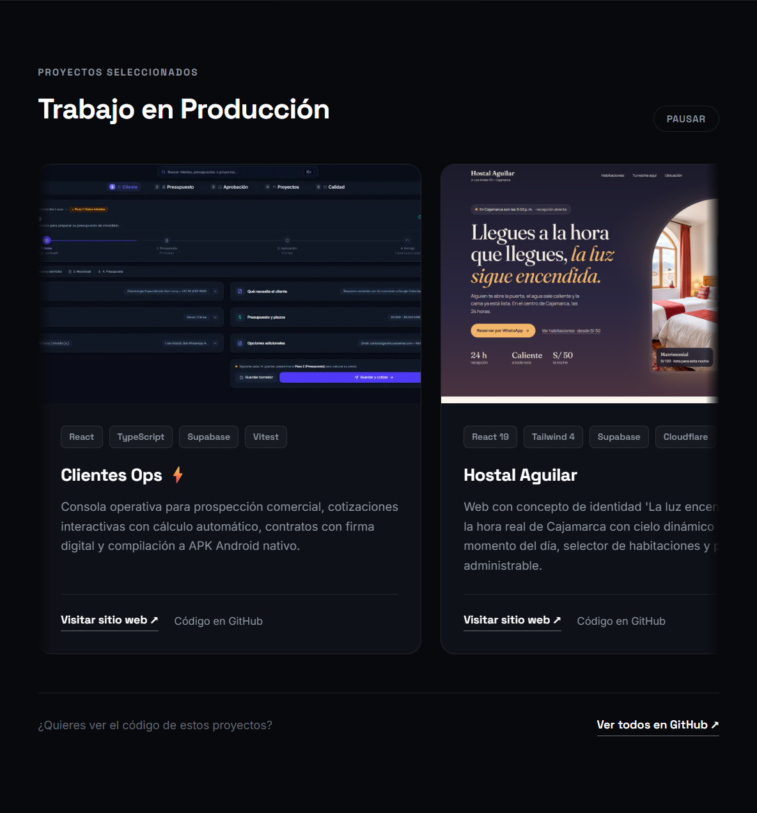

<div align="center">

# Frank Abanto — Portafolio Frontend

**Diseño interfaces que combinan precisión técnica y estética contemporánea.**

[](https://frankusqabant.github.io/pagina-taller-maquetacion/portafolio-cv/)
[](https://github.com/FrankUsqAbant)

</div>

---

<div align="center">

### 👉 [**Haz clic en la imagen para abrir el portafolio**](https://frankusqabant.github.io/pagina-taller-maquetacion/portafolio-cv/)

<a href="https://frankusqabant.github.io/pagina-taller-maquetacion/portafolio-cv/">
  
</a>

</div>

---

## ✨ Sobre el proyecto

Portafolio personal construido con **HTML, CSS y JavaScript vanilla** — sin frameworks, sin build step, sin dependencias. El objetivo fue demostrar que se puede lograr una experiencia visual de alto nivel con la base de la web.

El diseño parte de una identidad editorial oscura: tipografía **Space Grotesk** para titulares e **Inter** para lectura, sobre un fondo casi negro con acentos azules. La pieza central del hero es una **credencial colgante interactiva** que reacciona al cursor con física de péndulo y un foco de luz que sigue al puntero.

<br>

<div align="center">
  
</div>

<br>

## 🎯 Características

<table>
<tr>
<td width="50%" valign="top">

### Interacción
- **Credencial con física de péndulo** — se inclina siguiendo el cursor con amortiguación suave
- **Spotlight dinámico** — el resplandor sigue la posición del puntero sobre la tarjeta
- **Carrusel de desplazamiento continuo** — movimiento infinito a 30 px/s, sin saltos
- **Pausa inteligente** — se detiene al pasar el cursor, al enfocar con teclado, fuera de pantalla y al cambiar de pestaña

</td>
<td width="50%" valign="top">

### Calidad
- **Accesibilidad** — foco visible, `aria-*` correctos, navegación completa por teclado, landmarks semánticos
- **`prefers-reduced-motion`** — desactiva animaciones y convierte el carrusel en tira desplazable
- **Rendimiento** — 247 KB totales, CLS 0, FCP ~200 ms
- **Responsive** — verificado de 320 px a 1920 px sin desbordes

</td>
</tr>
</table>

## 🛠 Stack

<div align="center">


</div>

## 📁 Estructura

```
pagina-taller-maquetacion/
├── README.md
├── docs/                        # Capturas para este README
│   ├── hero.png
│   └── proyectos.png
└── portafolio-cv/
    ├── index.html               # Marcado semántico
    ├── style.css                # Sistema de diseño y animaciones
    ├── script.js                # Datos de proyectos + interacción
    └── assets/
        ├── CV_Frank_Abanto.pdf
        ├── favicon.png
        ├── frank-profile.jpg
        └── projects/            # Capturas de cada proyecto
```

## 🚀 Ejecutar en local

No requiere instalación ni build. Basta con servir la carpeta:

```bash
# Opción 1 — Python
python -m http.server 5500

# Opción 2 — Node
npx serve .
```

Luego abre <http://localhost:5500/portafolio-cv/>

## ➕ Agregar un proyecto

Los proyectos viven en un array en `script.js`. Para añadir uno nuevo basta con agregar un objeto — no hay que tocar el HTML:

```js
{
  title: 'Nombre del proyecto',
  image: 'assets/projects/mi-proyecto.webp',
  alt: 'Descripción de la imagen',
  tags: ['React', 'Tailwind CSS'],
  description: 'Una línea explicando qué hace y por qué importa.',
  url: 'https://mi-proyecto.pages.dev',
  repo: 'https://github.com/FrankUsqAbant/mi-proyecto', // opcional
}
```

El carrusel se reconstruye solo, duplica la lista para el bucle infinito y recalcula la duración según el ancho disponible.

## 📬 Contacto

<div align="center">

[](https://wa.me/51975713580)
[](https://www.linkedin.com/in/frank-abanto-3919841b2/)
[](https://github.com/FrankUsqAbant)

</div>

---

<div align="center">
<sub>© 2026 Frank Abanto · Frontend Developer · Cajamarca, PE</sub>
</div>
