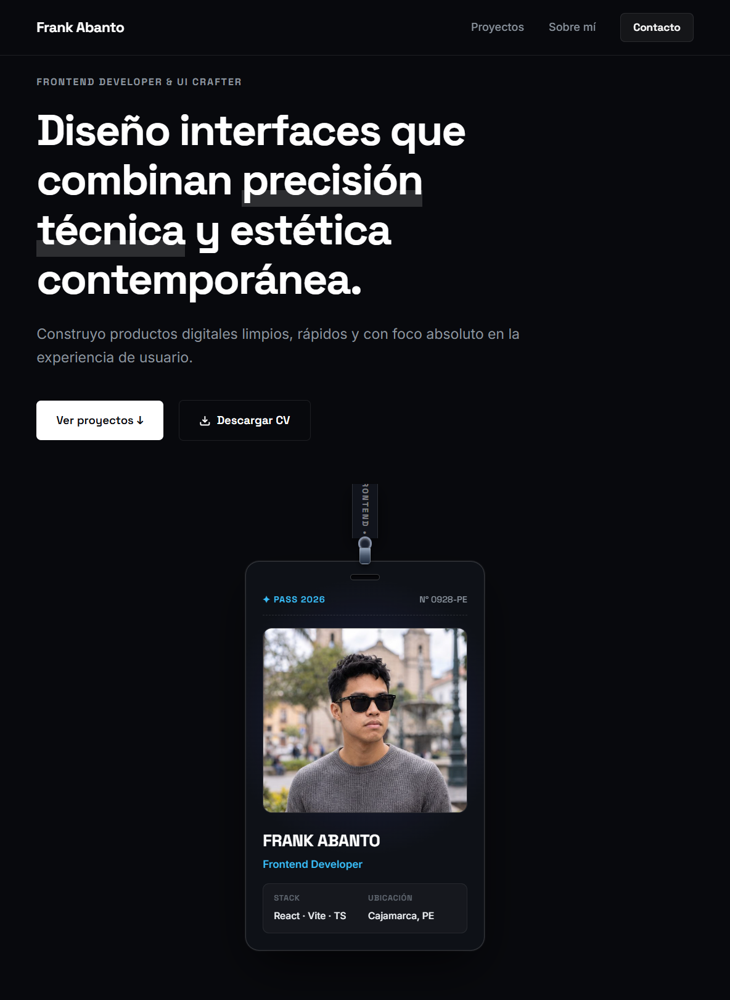

<div align="center">

# Frank Abanto — Portafolio Frontend

**Diseño interfaces que combinan precisión técnica y estética contemporánea.**

[](https://frankusqabant.github.io/pagina-taller-maquetacion/portafolio-cv/)
[](LICENSE)

<a href="https://frankusqabant.github.io/pagina-taller-maquetacion/portafolio-cv/">
  
</a>

</div>

## Sobre el proyecto

Portafolio personal en **HTML, CSS y JavaScript vanilla** — sin frameworks, sin build step, sin dependencias. La pieza central del hero es una credencial colgante con física de péndulo que sigue al cursor.

## Características

- **Credencial interactiva** — se inclina siguiendo el cursor, con spotlight dinámico
- **Carrusel continuo** — desplazamiento infinito a 30 px/s, con pausa al pasar el cursor, al enfocar con teclado, fuera de pantalla y al cambiar de pestaña
- **Accesibilidad** — foco visible, `aria-*` correctos, navegación por teclado, landmarks semánticos
- **`prefers-reduced-motion`** — desactiva animaciones y convierte el carrusel en tira desplazable
- **Rendimiento** — 247 KB totales, CLS 0, FCP ~200 ms
- **Responsive** — verificado de 320 px a 1920 px sin desbordes

## Stack


## Agregar un proyecto

Los proyectos viven en un array en `portafolio-cv/script.js`. Basta con añadir un objeto — el carrusel se reconstruye solo:

```js
{
  title: 'Nombre del proyecto',
  image: 'assets/projects/mi-proyecto.webp',
  alt: 'Descripción de la imagen',
  tags: ['React', 'Tailwind CSS'],
  description: 'Una línea explicando qué hace y por qué importa.',
  url: 'https://mi-proyecto.pages.dev',
  repo: 'https://github.com/FrankUsqAbant/mi-proyecto', // opcional
}
```

## Contacto

[](https://wa.me/51975713580)
[](https://www.linkedin.com/in/frankabanto/)
[](https://github.com/FrankUsqAbant)

## Licencia

Distribuido bajo la licencia **MIT**. Consulta [LICENSE](LICENSE) para más detalles.

---

<div align="center">
<sub>© 2026 Frank Abanto · Frontend Developer · Cajamarca, PE</sub>
</div>
